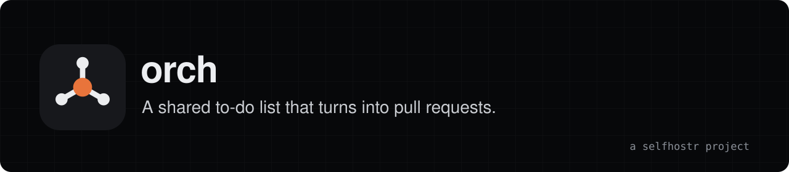
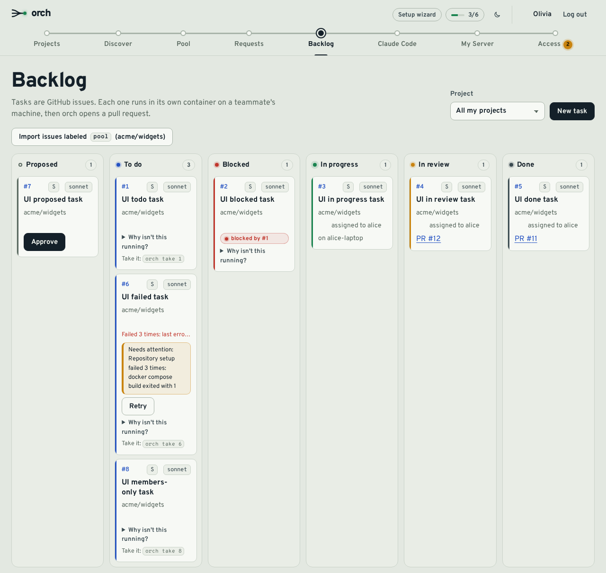

<div align="center">

<a href="https://orch.selfhostr.io"></a>

<h3>A shared to-do list for small, trusted teams, run on each member's own Claude subscription.</h3>

<a href="https://orch.selfhostr.io"></a>
<a href="https://orch.selfhostr.io/docs/"></a>
<a href="https://github.com/selfhostr/orch/releases"></a>

<br><br>

[](https://github.com/selfhostr/orch/actions/workflows/ci.yml)
[](https://scorecard.dev/viewer/?uri=github.com/selfhostr/orch)
[](LICENSE)

<br><br>



</div>

## Overview

Tasks are GitHub issues. A member, or Claude Code through MCP, adds them to a shared pool. Each task then runs on a teammate's own machine, with their own Claude subscription, in a throwaway container that only sees its own git clone. orch pushes a branch and opens a PR.

- **No pooled accounts.** The server sees task statuses and usage estimates, never Claude credentials. Member machines connect out over a WebSocket, so no inbound ports.
- **Docker everywhere.** Server, web, database, proxy, member agent, task sandboxes and every development workflow.
- **Free, for good.** MIT licence, no paid edition.

## Quick start

Server admin, once. You need a Linux host with Docker 26+ and Compose, ports 80 and 443, and a DNS name.

```sh
git clone https://github.com/selfhostr/orch.git && cd orch/deploy/server
cp .env.example .env     # fill it in, then create the GitHub App
docker compose up -d
```

Create the GitHub App, then sign in at `https://<domain>`. Each member gets a one-time command (valid 15 minutes) from **My Server** in the web UI:

```sh
curl -fsSL https://<domain>/install.sh | ORCH_TOKEN=<one-time-token> sh   # installs the agent
orch login                                                                # links your Claude account, stored locally
```

To submit and inspect tasks from Claude Code:

```sh
claude mcp add --transport http --scope user orch https://<domain>/mcp
```

Then run `/mcp`, pick **orch**, **Authenticate**.

Back up the database dumps **and** keep `.env` (notably `ORCH_ENCRYPTION_KEY`) and the GitHub App private key elsewhere: they are not in the dump. Full steps: [quick start](https://orch.selfhostr.io/docs/quickstart/), [server installation](https://orch.selfhostr.io/docs/installation/), [backups](https://orch.selfhostr.io/docs/backups/).

## Features

- **Pool and Backlog.** Issues with the project's pool label become tasks. The Pool shows who is lending capacity; budgets are estimates.
- **Auto or approval.** In `AUTO` the agent runs a task headlessly and the PR opens as a draft. In `APPROVAL` nothing starts until the member accepts. `orch pause` always refuses locally.
- **Manual mode.** `orch take <n>`, `orch attach <n>`, `orch done <n>` in a `screen` session.
- **Claude Code over MCP.** Tools `view_pool`, `list_tasks`, `submit_task`, `take_task`, `task_status`, with MCP OAuth 2.1 or personal access tokens. No LLM key on the server.
- **Access control.** Admins, allowlists of logins or organizations, access requests, invite links.
- **Notifications and observability.** In-app, browser, e-mail and webhook notifications; Prometheus metrics and OpenTelemetry traces.
- **Backups.** Scheduled `pg_dump` with rotation, optional age encryption and S3 upload.
- **Agent updates** from the web app, with rollback on failure.

## Architecture

Caddy (automatic HTTPS, static web build) fronts a Fastify server with Postgres; scheduled dumps run in a `backup` service. Each member runs an agent container that drives their local Docker and starts one non-root task container per task, with only its clone mounted. See [concepts](https://orch.selfhostr.io/docs/concepts/).

## Limits

orch is for **small teams who trust each other**. It is a shared to-do list with automation, not a multi-tenant platform.

> [!WARNING]
> Anyone who can get an issue labeled for the pool can, in effect, write a prompt that runs on a teammate's machine. Do not use orch with strangers or public repos where outsiders can file labeled issues.

- In auto mode the task container runs `claude -p --permission-mode bypassPermissions` with network access and the member's Claude token. There is no egress filtering. The token is the member's own and revocable.
- The agent is root-equivalent on the member's host (it mounts `/var/run/docker.sock`). Rootless Docker reduces this.
- Single server instance by default, no high availability. Usage and budget are estimates.
- Repos must build from a `Dockerfile` or a simple `.devcontainer.json`. GitHub only, English UI only.

Review auto-mode PRs and enable branch protection. The rest is in the [security model](https://orch.selfhostr.io/docs/security/).

## Status

Releases are `0.x`, so anything may change between minor versions. The [installation guide](https://orch.selfhostr.io/docs/installation/) covers upgrading and the one image-name change since v0.9.0.

## Contributing

Everything runs in Docker; the host needs only `docker` with Compose and `sh`. Start with the [development guide](docs/development.md) (`./dev up`, `./dev test`). Security issues: [SECURITY.md](SECURITY.md).

## License

MIT, see [LICENSE](LICENSE). orch is provided "as is", without warranty of any kind. The authors and contributors accept no liability for any damage, leaked token or unwanted change pushed to a repository; validating it in your own environment is up to you.

## Support orch

orch is free and has no company behind it. If it saves you time, you can support its development:

- **GitHub Sponsors** (recurring or one-off): [github.com/sponsors/selfhostr](https://github.com/sponsors/selfhostr)
